# Salsa — LASAPI (Linux Audio Session API) Portable Installer

<p align="center">
  <strong>📖 Overview</strong> &nbsp;|&nbsp;
  <a href="#screenshots">🖼️ Screenshots</a> &nbsp;|&nbsp;
  <a href="SALSA%20Architecture%20Breakdown.md">📐 Architecture Breakdown</a> &nbsp;|&nbsp;
  <a href="PATCH_NOTES.md">📝 Patch Notes (V1.24.14)</a> &nbsp;|&nbsp;
  <a href="SUPPORT.md">🛠️ Support &amp; Debugger</a> &nbsp;|&nbsp;
  <a href="CONTRIBUTING.md">🤝 Contributing</a> &nbsp;|&nbsp;
  <a href="SECURITY.md">🔒 Security</a> &nbsp;|&nbsp;
  <a href="THIRD_PARTY_LICENSES.md">🔌 Third-Party &amp; Codecs</a> &nbsp;|&nbsp;
  <a href="COPYING.LESSER">⚖️ LGPL-3.0 License</a>
</p>

**"You can't spell Salsa without ALSA — because even the cleanest audio chips sound flat until they have a zero-latency dip to taste, with zero chunks dropped and plenty of Dynamic EQ heat!"**

High-Frequency (Up to **192,000 Hz / 32-Bit Float**) **Linux Audio Session API (`LASAPI`)** — Windows-style Architecture / WaveRT Zero-Copy Audio Engine, **100% Pure Rust Backend Daemon & CLI (`lasapi-audiodg` / `lasapi-ctl`), PA v35 Server & Zero-Downtime `pipewire-0` Video Broker**, **Direct BlueZ D-Bus A2DP/HFP/AVRCP Audio (`LDAC / aptX HD / aptX / AAC / SBC`)**, **10-Band Real-Time Dynamic EQ APO**, Sample-Accurate **DAW MIDI Hub**, **Native Wayland Qt6 UI (`LayerShellQt`)**, and Automatic **`qpwgraph`-Equivalent Signal Topology & Owner's Manual**, **Designed to remove all PipeWire-Pulse or WirePlumber audio dependencies**.  

---

## Screenshots

### Salsa Studio — Main Mixer, 10-Band Dynamic EQ & Sessions (`salsa`)
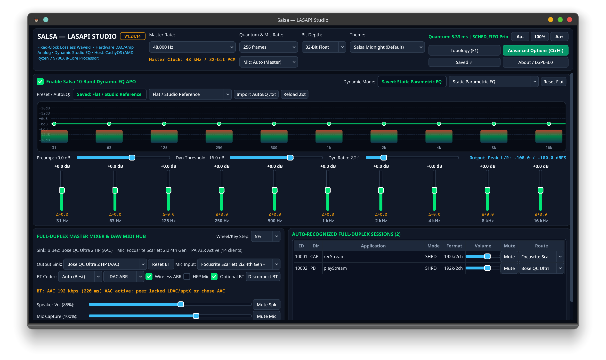

### Auto-Graph Topology & Interactive Owner's Manual (`salsa-graph`)
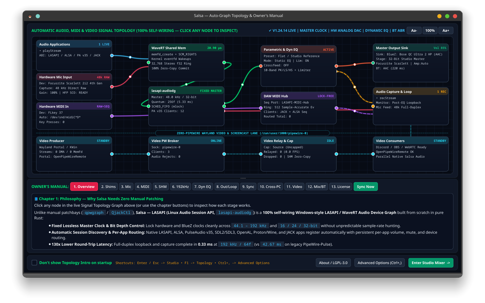

### Advanced Options, DSP, Hardware Analog & Diagnostics (`salsa --advanced`)
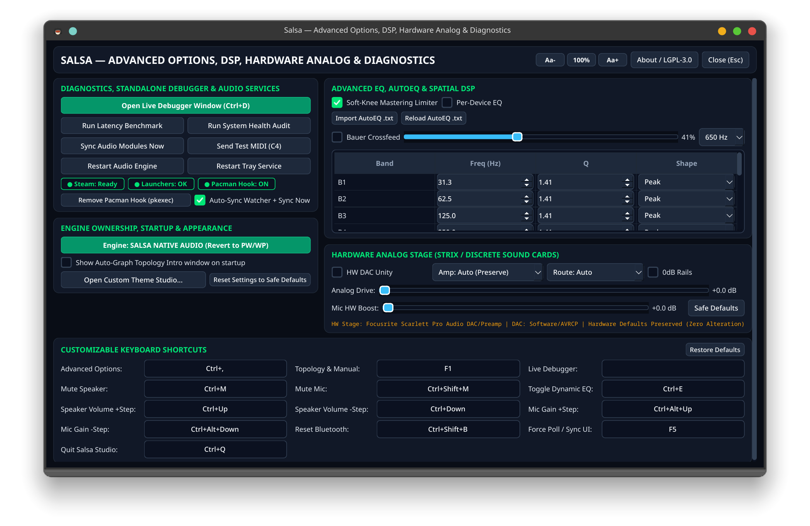

### Custom Theme Studio — Live Interactive Preview (`salsa --theme-studio`)
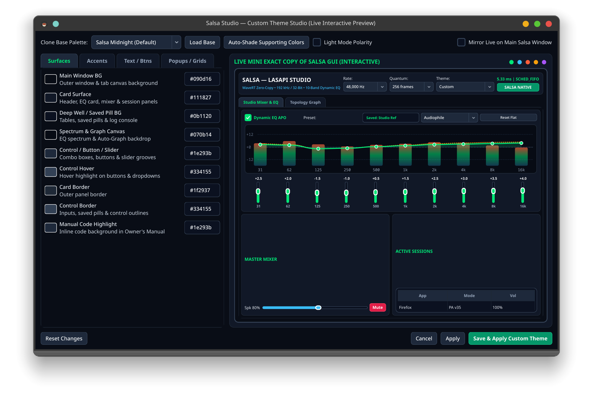

### System Tray Quick Mixer (`lasapi-tray`) & About / LGPL-3.0 Viewer (`salsa --about`)
<table>
  <tr>
    <th align="center">System Tray Quick Mixer (<code>lasapi-tray</code>)</th>
    <th align="center">About &amp; LGPL-3.0 License Viewer (<code>salsa --about</code>)</th>
  </tr>
  <tr>
    <td align="center" width="42%">
      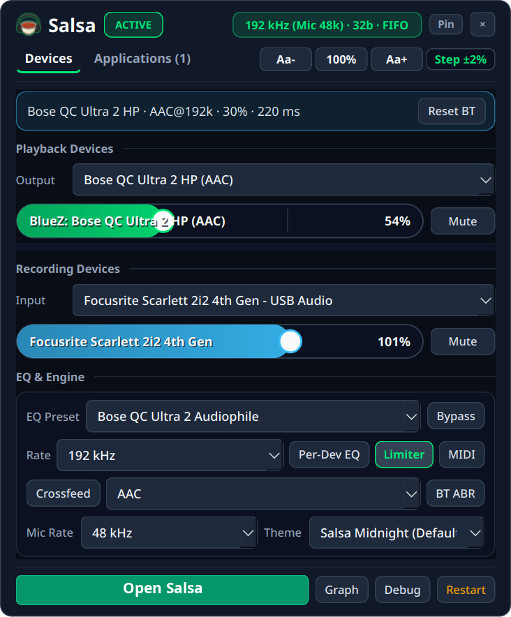
    </td>
    <td align="center" width="58%">
      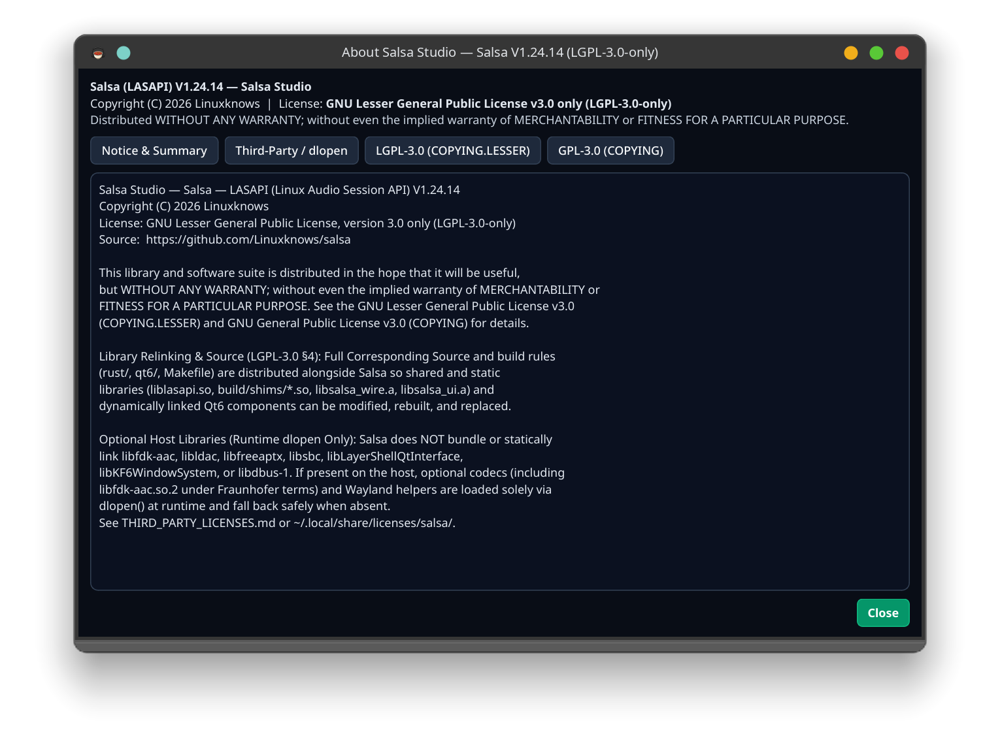
    </td>
  </tr>
</table>

### Standalone Live Architecture & IPC Debugger (`salsa-debug`)
<table>
  <tr>
    <th align="center">Live Event Stream (<code>--tab 0</code>)</th>
    <th align="center">App &amp; Process Routing Audit (<code>--tab 1</code>)</th>
  </tr>
  <tr>
    <td align="center">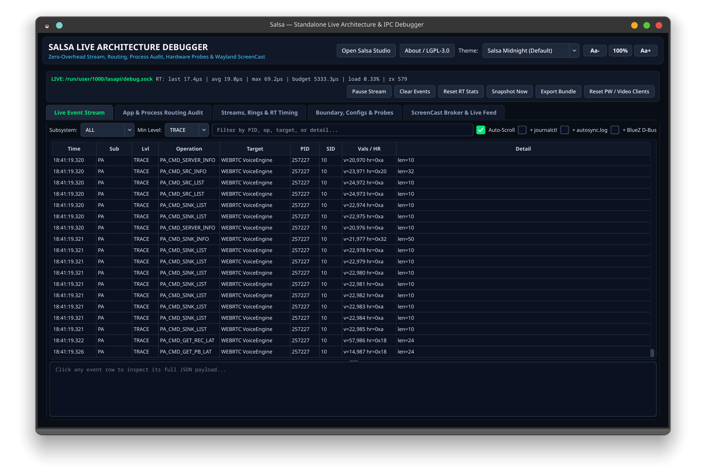</td>
    <td align="center">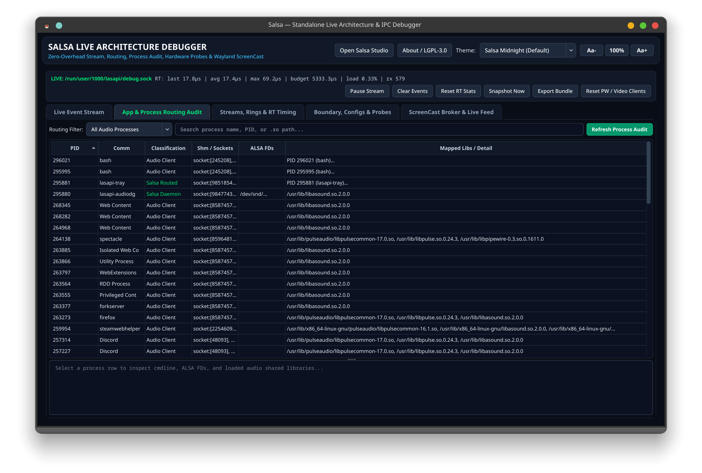</td>
  </tr>
  <tr>
    <th align="center">Streams, Rings &amp; RT Timing (<code>--tab 2</code>)</th>
    <th align="center">Boundary, Configs &amp; Probes (<code>--tab 3</code>)</th>
  </tr>
  <tr>
    <td align="center">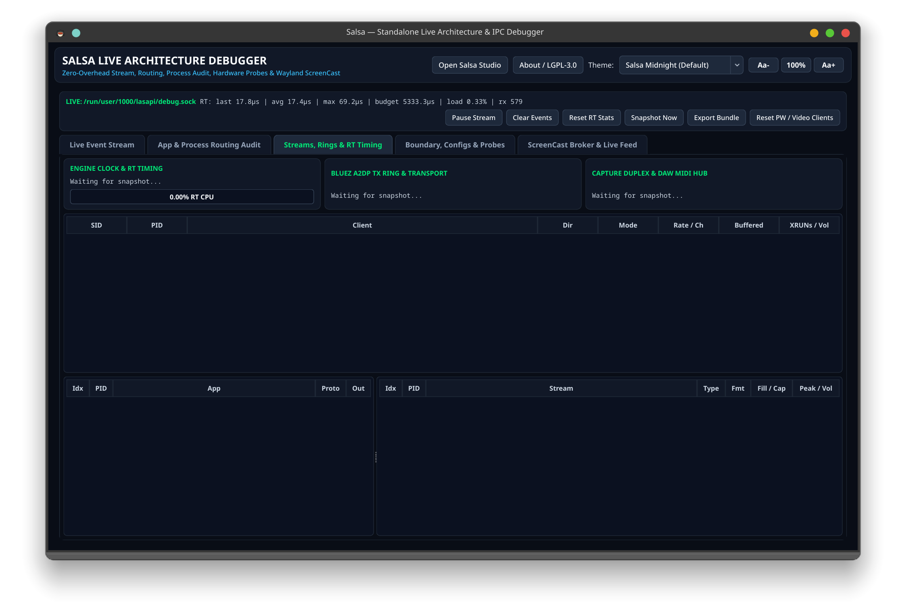</td>
    <td align="center">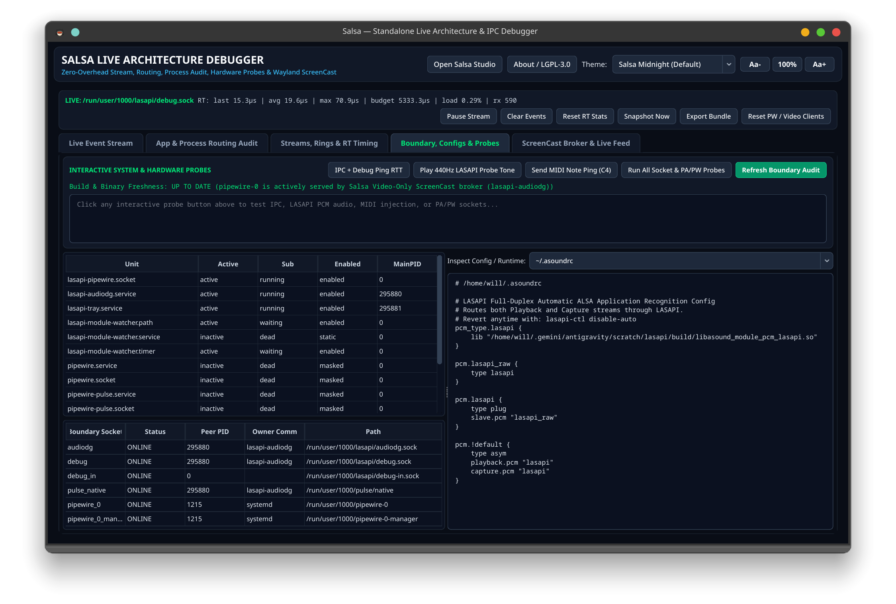</td>
  </tr>
  <tr>
    <th align="center" colspan="2">ScreenCast Broker &amp; Live Feed (<code>--tab 4 --live-feed</code>)</th>
  </tr>
  <tr>
    <td align="center" colspan="2">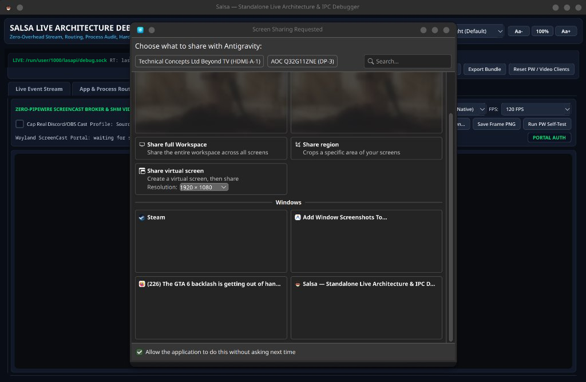</td>
  </tr>
</table>

---

## Architecture Breakdown

Read the complete 4-stage engine walkthrough, zero-copy WaveRT shared-memory ring design (`memfd_create` + `eventfd`), PA v35 server, direct BlueZ A2DP pipeline, and Zero-PipeWire Wayland ScreenCast broker details in **[SALSA Architecture Breakdown](SALSA%20Architecture%20Breakdown.md)**.

<details>
<summary>📐 Preview Signal Flow &amp; Zero-PipeWire Architecture Summary</summary>

1. **Inputs & Applications (`pa_server.rs`, `build/shims/`, `~/.asoundrc`)**: Auto-routes Native LASAPI (`liblasapi.so`, bridged into virtual PA `direct_on_input` monitor taps for Discord/OBS app sound share), Native PulseAudio v35 (`$XDG_RUNTIME_DIR/pulse/native`), ALSA/OpenAL Soft clients, and zero-IPC hollow ABI shims (`lasapi-run`).
2. **WaveRT Zero-Copy Engine (`memfd_create` + `eventfd`)**: Streams up to `192,000 Hz / 32-bit Float` through anonymous `32,768`-frame shared-memory rings mapped via `SCM_RIGHTS` with atomic commits (`~75–80 ns`).
3. **Salsa APO & DAW MIDI Hub (`lasapi-audiodg`, `SCHED_FIFO 65`, `mlockall`)**: Mixes multi-rate streams into a fixed or split playback/capture master clock, applies the 10-band dynamic parametric EQ (`31 Hz–16 kHz`), Bauer headphone stereo crossfeed, and soft-knee limiter, and routes raw MIDI (`RawMIDI` / ALSA Sequencer).
4. **Hardware Endpoints & Video ScreenCast Broker (`pw_broker.rs`)**: Outputs directly to kernel `/dev/snd/pcmC*D*` DACs (with smart headphone/USB/jack hotplug priority) or `org.bluez.MediaEndpoint1` Bluetooth A2DP/HFP endpoints (**LDAC / aptX HD / aptX / AAC / SBC**), provides full-duplex loopback capture, and serves zero-downtime socket-activated `$XDG_RUNTIME_DIR/pipewire-0` strictly for Wayland ScreenCast `DmaBuf`/`MemFd` video relays while rejecting PipeWire audio.

👉 Open the full document with ASCII signal topology diagrams: **[SALSA Architecture Breakdown.md](SALSA%20Architecture%20Breakdown.md)**

</details>

---

## Quick 1-Command Install on Any Linux PC

Unzip the archive (for example `V1.24.14` from [VERSION](VERSION)) and run `./install-salsa.sh`. Full chronological change history is available in [PATCH_NOTES.md](PATCH_NOTES.md).

```bash
unzip "salsa-lasapi-installer (V1.24.14).zip"
cd salsa-lasapi
./install-salsa.sh
```

### What `./install-salsa.sh` Does Automatically:
1. **Detects Host PC Hardware & Distro**: Identifies your CPU (`/proc/cpuinfo`), Linux distribution (`CachyOS`/Arch `pacman`, Ubuntu/Debian `apt`/`dpkg`, Fedora/RHEL/openSUSE `dnf`/`zypper`/`rpm`), kernel ALSA soundcards (`/proc/asound/cards`), Bluetooth A2DP headphones (`org.bluez`), USB/analog capture inputs, and hardware MIDI controllers (`/dev/snd/midiC*D*`).
2. **Installs Any Missing Build/GUI Prerequisites**: Checks for `cargo`, `gcc`, `g++`, `make`, `pkg-config`, `readelf`, `libz`/`alsa`/`libpulse` runtime libraries, and `Qt6` (`libQt6Widgets.so.6`, `libQt6DBus.so.6` from `qt6-base`) for the native C++20 Qt6 + pure-Rust GUIs (`build/salsa-studio`, `build/salsa-debug`, `build/lasapi-tray`), installing system prerequisites cleanly when needed.
3. **Syncs Host ELF Symbol Versions & Compiles Natively (`build/lasapi-autosync`)**: Extracts the target PC's exact `ALSA_*` and `PULSE_*` ELF symbol versions from `libasound.so.2` and `libpulse.so.0` and builds `lasapi-audiodg`, `liblasapi.so`, `libasound_module_pcm_lasapi.so`, `build/pa_reconnect/libpulse.so.0` (plus `build/pa_reconnect32/libpulse.so.0` when 32-bit multilib is present), `lasapi-ctl`, `lasapi-test`, `lasapi-bench`, and all hollow ABI shims (`build/shims/`).
4. **Cuts Over Audio Directly to Salsa (`lasapi-ctl enable-auto`)**:
   - Configures Pure Zero-PipeWire isolation with built-in ScreenCast `$XDG_RUNTIME_DIR/pipewire-0` video broker, `~/.asoundrc`, `~/.config/OpenAL/alsoft.conf`, `~/.config/environment.d/99-salsa-direct.conf`, native `$XDG_RUNTIME_DIR/pulse/native` PA v35 UNIX socket server, persistent `0600` `~/.config/lasapi/app_volumes.conf`, and direct BlueZ `MediaEndpoint1` (**LDAC / aptX HD / aptX / AAC / SBC**) + kernel `/dev/snd/pcmC*D*`.
   - Applies scoped Flatpak `--user` overrides (`--socket=pulseaudio`, `--filesystem=xdg-run/pipewire-0:ro`) for installed gaming/media Flatpaks and tracks them for clean `--uninstall` rollback.
5. **Configures & Starts Systemd User Services & Shortcuts**:
   - `lasapi-pipewire.socket` (Zero-downtime `$XDG_RUNTIME_DIR/pipewire-0` & `pipewire-0-manager` socket activation so KDE `libKPipeWire` `MediaMonitor` never drops across restarts)
   - `lasapi-audiodg.service` (Real-time `SCHED_FIFO` WaveRT audio, PA v35 server, direct BlueZ, MIDI hub, & live debug telemetry socket)
   - `lasapi-tray.service` (Pure native Wayland `LayerShellQt` system tray Quick Mixer & volume OSD with automatic X11/EWMH fallback)
   - `lasapi-module-watcher.path` & `lasapi-module-watcher.timer` (Automatic self-healing SHA-256 ABI sync whenever host audio, Bluetooth codec, or D-Bus shared libraries update; optional root-safe ALPM trigger via `./install-salsa.sh --install-pacman-hook`)
   - Application Launcher shortcuts (`~/.local/share/applications/`): **Salsa Audio Studio** (`salsa-lasapi.desktop`), **Salsa — Live Interaction Debugger** (`salsa-debug.desktop`), and **Salsa — Audio System Tray** (`lasapi-tray.desktop`)
   - CLI & GUI Commands in `~/.local/bin/`: `salsa`, `salsa-graph`, `salsa-debug`, `salsa-debug-cli`, `lasapi-ctl`, `lasapi-run`, `lasapi-bench`, `lasapi-tray`

---

## Useful Commands

- **Open Salsa Studio Mixer, Device Switcher, Advanced Options, Theme Studio, or About Dialog**:
  ```bash
  salsa
  salsa --studio
  salsa --advanced
  salsa --theme-studio
  salsa --about
  ```
- **Open Automatic Signal Topology Graph (`qpwgraph` View) & Owner's Manual**:
  ```bash
  salsa-graph
  ```
- **Open Standalone Live Interaction Debugger or Run CLI Audits/Probes**:
  ```bash
  salsa-debug
  salsa-debug --tab 2
  salsa-debug --tab 4 --live-feed
  salsa-debug --export
  salsa-debug --text
  salsa-debug --snapshot
  salsa-debug --audit
  salsa-debug --export-text [output.txt]
  salsa-debug --probe --tone --midi
  salsa-debug --stream --lvl INFO
  ```
- **Inspect Engine Status, List Endpoints, or Control Devices & Per-App Streams**:
  ```bash
  lasapi-ctl status
  lasapi-ctl devices
  lasapi-ctl set-sink <device-id|auto>
  lasapi-ctl set-source <device-id|auto>
  lasapi-ctl app-volume <session_id> <0-150>
  lasapi-ctl app-mute <session_id> <0|1|toggle>
  lasapi-ctl move-app <session_id> <device-id|auto>
  ```
- **Run Automated Regression/Security Suite & Live Latency Benchmark**:
  ```bash
  make test
  lasapi-bench
  ```
- **Rebuild the Portable Installer Archive (`salsa-lasapi-installer (V1.24.14).zip`)**:
  ```bash
  make dist
  ```
- **Inspect Host PC Hardware Readiness Without Installing**:
  ```bash
  ./install-salsa.sh --check
  ```
- **Temporarily Revert Audio Ownership Back to Stock PipeWire-Pulse / WirePlumber**:
  ```bash
  lasapi-ctl disable-auto
  ```
- **Full Uninstall & Clean Restore of Stock PipeWire-Pulse / WirePlumber / ALSA**:
  ```bash
  ./install-salsa.sh --uninstall
  ```

---

## License

Copyright (C) 2026 **Linuxknows**

Salsa (LASAPI) is licensed under the **GNU Lesser General Public License v3.0 only (`LGPL-3.0-only`)** and is distributed **WITHOUT ANY WARRANTY**:

- [COPYING.LESSER](COPYING.LESSER) — GNU Lesser General Public License v3.0 permissions
- [COPYING](COPYING) — GNU General Public License v3.0 base terms (required alongside LGPL-3.0)
- [THIRD_PARTY_LICENSES.md](THIRD_PARTY_LICENSES.md) — Dynamically linked frameworks (Qt6 under `LGPL-3.0-only`, ALSA/Pulse/JACK), library relinking & source instructions (`make all`), and optional runtime `dlopen()` codec/Wayland disclosures (`libfdk-aac`, `libldac`, `libfreeaptx`, `libsbc`, `libLayerShellQtInterface`, `libKF6WindowSystem` — never bundled or vendored)

---

## Contributors

- **Linuxknows** — Creator & Maintainer
- **Antigravity (Google DeepMind — Gemini 4 Hydrogen)** — AI Pair-Programming Contributor
- **Thorr1337** — Beta Tester
